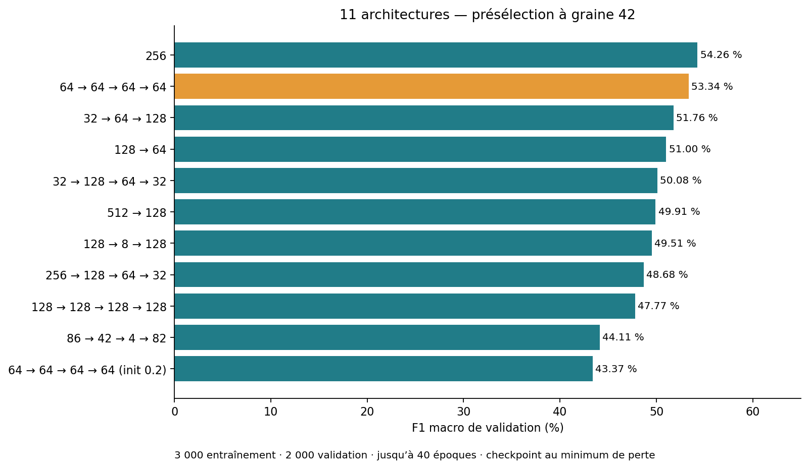

# My Torch

Réseau neuronal supervisé en Python et NumPy pour classer des positions d'échecs en FEN.
La création, l'inférence et la rétropropagation sont implémentées sans bibliothèque de
réseaux neuronaux. Le projet comprend un module importable, deux CLI et un dashboard bonus.

Le modèle à cinq sorties distingue `Checkmate White`, `Checkmate Black`, `Check White`,
`Check Black` et `Nothing`. La couleur désigne **le camp qui donne l'échec ou le mat**.
Les réseaux générés sont aléatoires : il faut les entraîner avant d'évaluer leur qualité.

## Installation et compilation

Environnement vérifié : Linux, Python 3.11, `make`. NumPy est nécessaire à l'exécution ;
`coverage` sert aux tests et `chess` à préparer les données, pas à calculer les prédictions.
Les commandes suivantes sont à lancer depuis la racine du dépôt :

```bash
python3 -m venv .venv
source .venv/bin/activate
python -m pip install -r tests/requirements-dev.txt
make
./my_torch_analyzer --help
./my_torch_generator --help
```

`make` construit deux archives zipapp depuis `src/`. Elles contiennent les modules Python,
mais pas NumPy : garder le venv activé, y compris après ouverture d'un nouveau terminal.
Le shebang `/usr/bin/env python3` utilise le Python trouvé dans le `PATH`.
Reconstruire avec `make` après toute modification du code source.

| Commande | Effet |
|---|---|
| `make` / `make all` | Construire `my_torch_analyzer` et `my_torch_generator`. |
| `make re` | Nettoyer complètement, puis reconstruire. |
| `make clean` | Supprimer les caches Python. |
| `make fclean` | Supprimer également les exécutables et rapports de couverture locaux. |
| `make tests_run` | Préparer `.venv-tests`, puis lancer unittest et coverage. |
| `make dashboard` | Préparer `.venv-dashboard`, puis démarrer l'interface locale. |
| `make dashboard_tests` | Exécuter les tests du dashboard. |

## Prédire avec le modèle livré

```bash
./my_torch_analyzer --predict my_torch_network_1.nn \
  tests/dataset_example/check/10_pieces.txt
```

Une ligne de label est écrite sur stdout pour chaque position valide, dans l'ordre du fichier.
Exemple de format, sans promesse sur les réponses d'un modèle donné :

```text
Check White
Nothing
Check Black
```

Il n'y a ni bannière, ni score, ni bilan d'accuracy dans la sortie CLI actuelle. Utiliser le
dashboard pour les métriques. Les annotations éventuelles ne sont jamais des entrées du réseau.
Voir la [fiche du modèle livré](docs/model-card.md) avant de citer des performances.

## Générer et entraîner un nouveau réseau

```bash
./my_torch_generator tests/conf_example/architectures/baseline256.conf 1
./my_torch_analyzer --train --save my_torch_network_trained.nn \
  my_torch_network_baseline256_1.nn dataset/generated/train.txt
```

La seconde commande nécessite un dataset local : voir [préparation des données](scripts/README.md).
Les datasets volumineux ne sont pas fournis par un clone Git ; les conserver pour la soutenance.
Pour un simple test fonctionnel, les petites fixtures sont disponibles dans `tests/dataset_example/` ;
elles ne constituent pas un corpus équilibré pour mesurer la qualité du modèle.

Le générateur refuse d'écraser un `.nn` existant. Pour répéter l'expérience, changer `name`
dans une copie de la configuration ou utiliser un nouveau répertoire de sortie.
Sans `--save`, l'entraînement remplace le fichier `LOADFILE`. Avec `--save`, il conserve l'original.
Les journaux d'entraînement sont écrits sur stderr. Les paramètres de patience et d'époque
sont lus dans le `.nn`, pas dans un `.conf` modifié après sa génération.

## Contrat des lignes de commande

```text
./my_torch_generator config_file_1 nb_1 [config_file_2 nb_2 ...]
./my_torch_analyzer [--predict | --train [--save SAVEFILE]] LOADFILE CHESSFILE
```

- Exactement un mode : `--train` ou `--predict` ; `--save` seulement avec `--train`.
- En entraînement, chaque position utilisable doit porter un label compatible avec le modèle.
- En prédiction, le label est facultatif. Les fichiers contiennent une position par ligne.
- `--help` et les opérations réussies quittent avec 0. Les erreurs CLI validées quittent avec 84
  et un diagnostic sur stderr. Certains fichiers malformés restent mal gérés : voir les limites.
- `Ctrl+C` pendant l'apprentissage sauvegarde la dernière époque complète et quitte avec 130.
  Une terminaison forcée ne peut conserver que le dernier checkpoint déjà écrit.

Exemple FEN annoté pour les cinq classes :

```text
4k3/8/8/8/8/8/4R3/4K3 b - - 0 12 Check White
```

Le roi noir est en échec par la tour blanche. Les labels à trois classes (`Check`, etc.)
ne sont pas convertis automatiquement pendant l'entraînement d'un modèle à cinq sorties.

## Configurations et résultats

- [Configuration recommandée mesurée](tests/conf_example/architectures/baseline256.conf) : `838 → 256 → 5`.
- [Configuration initiale](tests/conf_example/chess_network.conf) : `838 → 128 → 64 → 5`.
- [Onze architectures expérimentales](tests/conf_example/architectures/) : profondeur, goulots, pyramides.
- [Formats `.conf`, `.nn` et FEN](docs/formats.md) : paramètres, dimensions et conventions.

La comparaison sur trois graines donne **53,18 % de F1 macro en validation** pour `256`,
contre **50,68 %** pour quatre couches de 64 neurones. Sur le jeu de test, la référence
atteint **55,90 % d'accuracy et 54,22 % de F1 macro** en moyenne. Ces modèles ont été entraînés
sur 6 000 positions ; ces chiffres ne décrivent pas automatiquement le `.nn` livré à la racine.
Les performances restent modestes et ne démontrent pas un optimum global.



[Rapport de benchmark avec courbes, matrice de confusion et protocole](docs/benchmarks.md).

## Dashboard et bonus

```bash
make dashboard
```

Ouvrir **http://127.0.0.1:8501**. Le dashboard propose entraînement avec validation distincte,
arrêt contrôlé, courbes de perte et d'accuracy, prédictions, F1 macro, matrice de confusion,
comparaison d'expériences et exports HTML/CSV. [Guide détaillé](bonus/dashboard/README.md).
Chaque expérience conserve ses propres fichiers dans `.dashboard_runs/`, ignoré par Git.
Le pat comme classe distincte, une IA jouant une partie et l'apprentissage parallèle ne sont pas implémentés.

## Tests et état vérifié

```bash
make tests_run
make dashboard_tests
```

État du 5 novembre 2026 : **156 tests principaux, 4 échecs ; 8 tests dashboard réussis ;
93 % de couverture sur `src/`, branches activées**. Une couverture élevée ne signifie pas que
les tests passent. `make tests_run` s'arrête actuellement sur l'échec unittest avant les rapports.
Les commandes pour consulter tout de même la couverture et le détail des échecs figurent
[dans le guide de validation](docs/testing.md). Le workflow GitHub actuel fait un miroir ; il ne lance pas les tests.

## Documentation du projet

| Document | Contenu |
|---|---|
| [Index et exigences du sujet](docs/README.md) | Correspondance avec les pages du PDF et état des livrables. |
| [Architecture et API](docs/architecture.md) | Module importable, responsabilités et exemple générique. |
| [Formats](docs/formats.md) | Configuration, modèle persistant, FEN et encodage 838 valeurs. |
| [Apprentissage et choix](docs/training.md) | Formules, SGD, activations, validation et early stopping. |
| [Données](scripts/README.md) | Préparation, audit, séparation et reproduction. |
| [Benchmarks](docs/benchmarks.md) | Preuves visuelles, métriques, résultats et limites. |
| [Modèle livré](docs/model-card.md) | Identité du fichier, réglages et provenance connue/inconnue. |
| [Validation et dépannage](docs/testing.md) | Tests automatisés, couverture, commandes vérifiées et défauts connus. |

## Dépannage rapide

- `No module named numpy` : activer le venv et y installer les dépendances.
- `No module named coverage` : utiliser `make tests_run`, qui prépare `.venv-tests`.
- `Archive has no entry point` : utiliser le Makefile actuel, qui précise `-m analyzer:main`.
- `Unknown label 'Checkmate'` : adapter les annotations à trois ou cinq classes selon le modèle.
- Fichier FEN rejeté : corriger les champs signalés ; un compteur de 275 n'est pas invalide par sa seule taille.
- Après une modification, résultat inchangé : reconstruire les zipapps avec `make`.
