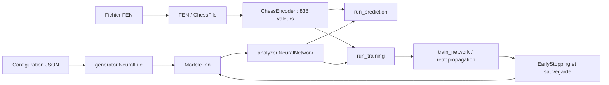

# Architecture et API du module

Le module du sujet est un ensemble de modules Python directement importables depuis `src/`.
Le générateur CLI seul n'est pas la bibliothèque : il utilise les mêmes classes importables
que les autres outils. Aucune installation de package n'est nécessaire si `src` est dans `PYTHONPATH`.



## Responsabilités

| Fichier | Rôle |
|---|---|
| `src/generator/configfile.py` | Lire la configuration JSON. |
| `src/generator/neuralfile.py` | Initialiser les poids/biais, produire des listes JSON, créer un fichier sans écrasement. |
| `src/analyzer/args.py`, `src/generator/args.py` | Parser les arguments et valider les modes, chemins et nombres. |
| `src/analyzer/application.py` | Charger les fichiers et choisir une seule fois train ou predict. |
| `src/analyzer/chess/` | Lire les FEN et construire le vecteur de caractéristiques. |
| `src/analyzer/neural_network.py` | Charger, propager, prédire et sauvegarder le réseau. |
| `src/analyzer/activation.py` | Fonctions d'activation et dérivées par rapport à la préactivation. |
| `src/analyzer/training.py` | SGD générique, préparation FEN, séparation et orchestration d'entraînement. |
| `src/analyzer/early_stopping.py` | Surveiller la perte et conserver les meilleurs paramètres. |
| `src/analyzer/metrics.py` | Mesurer sans mise à jour des paramètres. |
| `src/training_config.py` | Valeurs par défaut et validation des paramètres d'arrêt. |
| `bonus/dashboard/` | Interface, travail en arrière-plan, graphiques et exports. |
| `scripts/generate_dataset.py` | Préparer et contrôler les données sources. |

Les primitives `NeuralNetwork`, `train_network`, `evaluate_loss` et `EarlyStopping` ne nécessitent
pas une entrée FEN. `run_training` et `run_prediction` sont les adaptateurs spécifiques aux échecs.
Il n'existe pas encore une façade publique unique ni un package installable ; l'import direct
est le mode d'utilisation fourni.

## Exemple générique exécutable

Depuis la racine, dans le venv contenant NumPy :

```bash
PYTHONPATH=src python - <<'PYTHON'
import json
import random
from pathlib import Path
from tempfile import TemporaryDirectory
import numpy as np
from generator.configfile import ConfigFile
from generator.neuralfile import NeuralFile
from analyzer.neural_network import NeuralNetwork
from analyzer.training import train_network, evaluate_loss

with TemporaryDirectory() as directory:
    path = Path(directory)
    config = {
        "name": str(path / "generic"), "layers": [2, 4, 2],
        "seed": 42, "init": 0.1, "learning_rate": 0.05,
        "hidden_activation": "relu", "output_activation": "softmax",
        "labels": ["negative", "positive"],
        "max_epochs": 10, "patience": 5, "min_delta": 0.00001,
    }
    config_path = path / "generic.conf"
    config_path.write_text(json.dumps(config))
    model_path = NeuralFile(ConfigFile(config_path)).create_file()
    network = NeuralNetwork.load_from_file(model_path)
    examples = [
        (np.array([0., 0.], dtype=np.float32), np.array([1., 0.])),
        (np.array([1., 1.], dtype=np.float32), np.array([0., 1.])),
    ]
    rng = random.Random(42)
    for epoch in range(1, 11):
        train_network(network, examples, epoch, rng=rng)
    network.save(path / "trained.nn")
    restored = NeuralNetwork.load_from_file(path / "trained.nn")
    print("loss:", evaluate_loss(restored, examples))
    print("prediction:", restored.predict(np.array([1., 1.], dtype=np.float32)))
PYTHON
```

Cet exemple démontre créer/entraîner/sauver/recharger sans échiquier. Deux exemples et dix
époques ne démontrent pas la qualité d'une classification générale. La boucle basse couche
ne déclenche pas automatiquement l'early stopping : c'est le rôle de l'orchestrateur.

## Principales interfaces

| Interface | Entrée / résultat |
|---|---|
| `ConfigFile(path).get_config()` | Dictionnaire JSON de configuration. |
| `NeuralFile(config).create_file()` | Crée un `.nn` exclusif et retourne son chemin. |
| `NeuralNetwork.load_from_file(path)` | Retourne un objet contenant dimensions, activations et paramètres NumPy. |
| `network.forward_pass(x)` | Liste des activations, entrée comprise ; sortie finale à l'indice `-1`. |
| `network.forward_pass(x, return_preactivations=True)` | Couple `(activations, preactivations)` pour la rétropropagation. |
| `network.predict(x)` | Couple `(label, score du neurone sélectionné)`. |
| `network.save(path)` | Sauvegarde atomique des paramètres et réglages. |
| `train_network(network, examples, epoch, rng=...)` | Une époque SGD ; retourne la perte moyenne en cours de mise à jour. Modifie aussi l'ordre de la liste. |
| `evaluate_loss(network, examples)` | Perte moyenne à paramètres fixes. |
| `evaluate_metrics(network, examples)` | Perte, accuracy, F1 macro, balanced accuracy, confusion et scores par classe. |
| `run_training(network, positions, save_path, ...)` | Adaptateur FEN, split, suivi, checkpoints et arrêt. |

`examples` est une liste de couples `(vecteur d'entrée, cible one-hot)` de dimensions adaptées
au réseau. Ne pas fournir un tableau colonne à la place d'un vecteur : les validations de forme
du chargeur et de `predict` ne sont pas encore exhaustives.

Options de `run_training` : `patience`, `min_delta`, `max_epochs` surchargent le `.nn` ;
`seed=42` pilote le mélange/split ; `validation_fraction=0.2` règle le split interne ;
`validation_positions` fournit une validation externe ; `observer` reçoit les métriques
par époque et l'événement final ; `should_stop` permet un arrêt coopératif. Une validation
externe ne doit pas partager d'entrée encodée identique avec l'entraînement.

Le dashboard emploie un thread pour garder l'interface réactive. Cela ne constitue pas
un algorithme parallèle d'apprentissage et n'est pas présenté comme le bonus de calcul parallèle.
