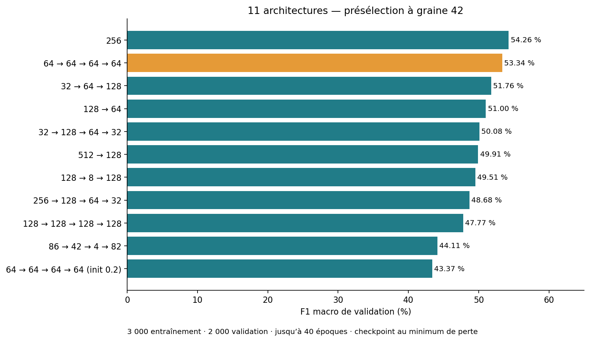
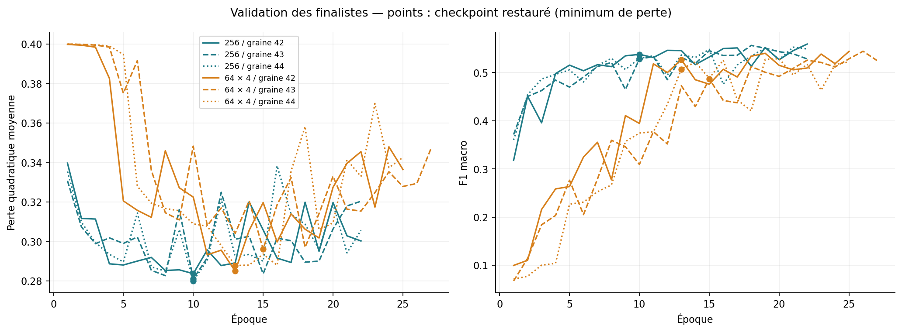
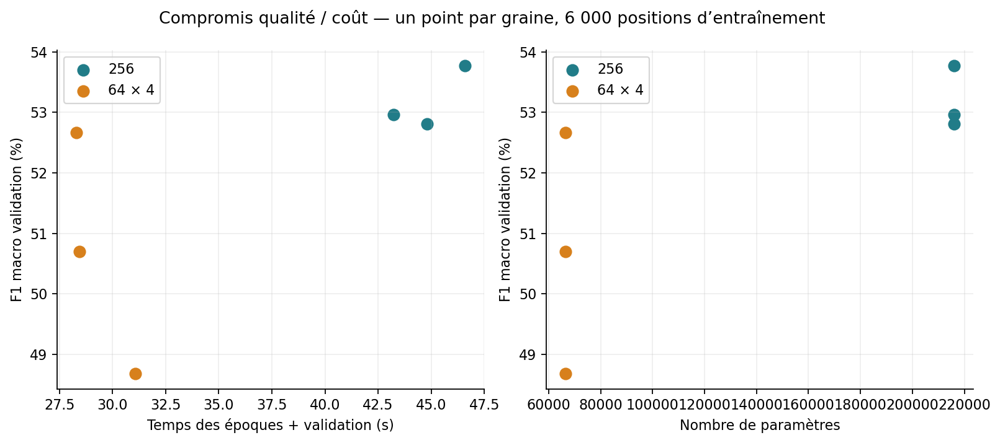
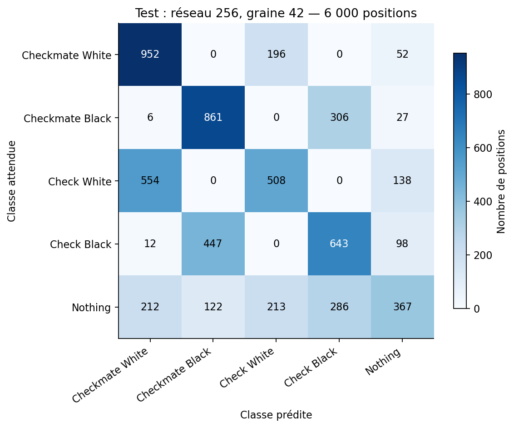

# Rapport de benchmark et preuves visuelles

Mesures enregistrées le **6 novembre 2026**, obtenues avec le moteur NumPy du projet.
Les figures ci-dessous sont calculées depuis les résultats JSON, sans estimation manuelle
et sans nouvel entraînement lors de la génération des graphiques.

## Questions étudiées et protocole

1. Quelle largeur/profondeur fonctionne le mieux dans un budget limité ?
2. Quel effet ont le taux d'apprentissage, l'amplitude initiale et l'activation ?
3. Une architecture profonde ou irrégulière apporte-t-elle un gain ?
4. Quel compromis entre F1 macro, temps et nombre de paramètres ?

Deux séries sont disponibles :

| Série | Présélection | Confirmation | Données de preuve |
|---|---|---|---|
| Réglages initiaux | 9 configurations, 3 000 train / 2 000 validation, ≤20 époques, graine 42 | Deux finalistes, 6 000 train / 2 000 validation, ≤40 époques, graines 42/43 ; patience 8 | [Rapport](../config_benchmark/README.md), [JSON](../config_benchmark/results.json) |
| Architectures créatives | 11 configurations, mêmes tailles, ≤40 époques, graine 42 | Deux finalistes, 6 000 train / 2 000 validation, ≤60 époques, graines 42/43/44 ; patience 12 | [Rapport](../config_benchmark/creative.md), [JSON](../config_benchmark/creative_results.json) |

La première série couvre les réseaux 64, 128→64, 256, des learning rates 0.001/0.003/0.01/0.03,
ReLU/SiLU et init 0.1/0.2 selon les candidats. Ce n'est pas une grille complète de toutes les combinaisons.
La seconde conserve ReLU, softmax et learning_rate=0.01, avec init=0.1 sauf une variante profonde à 0.2.

Chaque réseau part de poids neufs. La perte est quadratique, l'optimiseur SGD par position,
le checkpoint sélectionné par minimum de perte de validation. Le **classement** se fait par
F1 macro du checkpoint restauré, moyennée sur les graines en confirmation. Le même échantillon
est utilisé entre candidats d'une même étape ; aucun score de test ne sert au classement.

Les fichiers proviennent de `dataset/generated/` : 48 000 train, 6 000 validation et 6 000 test.
Les expériences utilisent des sous-ensembles équilibrés. Les familles de positions et leurs
miroirs sont disjointes entre ces fichiers. La graine d'échantillonnage est 20261105.
Les empreintes de données et les réglages exacts figurent dans les JSON ; les sources et leur
préparation sont décrites dans [le guide des données](../scripts/README.md).

BLAS est limité à un thread (`OPENBLAS_NUM_THREADS=1`, `OMP_NUM_THREADS=1`). Le temps rapporté
couvre les époques et la validation, hors encodage et sauvegardes JSON. Il dépend de la machine
et ne prédit pas directement la durée d'une commande CLI sur l'intégralité du corpus.

## Résultats visuels

### Présélection des architectures



Chaque barre représente une graine, le checkpoint au minimum de perte, 3 000 exemples train et
2 000 validation. Les réseaux profonds démarrent parfois lentement ; la limite d'époques et
la patience peuvent les défavoriser. Les finalistes sont ensuite réentraînés depuis zéro.

### Courbes des finalistes



Les points marquent l'époque restaurée. Il est possible d'observer ensuite une F1 plus élevée :
le programme choisit selon la **perte**, pas selon la F1. On ne remplace pas ce critère après
avoir vu les résultats. Les remontées de perte et les écarts train/validation signalent que
le surapprentissage n'est pas résolu.

### Qualité, temps et taille



| Finaliste | F1 validation moyenne (3 graines) | Écart-type descriptif | Paramètres | Temps moyen |
|---|---:|---:|---:|---:|
| 838 → 256 → 5 | 53,18 % | 0,43 point | 216 069 | 44,9 s |
| 838 → 64 → 64 → 64 → 64 → 5 | 50,68 % | 1,63 point | 66 501 | 29,3 s |

Le réseau profond réduit les paramètres d'environ 69 % et le temps d'environ 35 %, mais perd
2,50 points de F1 moyenne. Trois graines ne suffisent pas à établir une supériorité statistique
universelle. `256` reste le choix de qualité dans ce protocole ; `64 × 4` est une option compacte.

L'exemple irrégulier `838 → 86 → 42 → 4 → 82 → 5` obtient 44,11 % de F1 en présélection.
Il n'a pas été évalué sur trois graines : ne pas comparer ce nombre comme s'il avait le même
niveau de confirmation. L'étroitesse de la couche de quatre neurones contraint la représentation,
mais les mesures seules n'isolent pas son effet des autres réglages.

### Test du gagnant

Le modèle `256` est évalué sur les 6 000 positions de test après sélection :

| Graine | Accuracy | F1 macro |
|---|---:|---:|
| 42 | 55,52 % | 54,03 % |
| 43 | 56,03 % | 53,84 % |
| 44 | 56,15 % | 54,80 % |
| Moyenne | 55,90 % | 54,22 % |



Cette matrice présente **un modèle**, graine 42, sur 6 000 positions : les lignes sont les
labels attendus, les colonnes les prédictions. Ce n'est pas la somme de trois évaluations.
`Nothing` reste particulièrement difficile. Ces scores ne sont ni ceux du `.nn` livré à la
racine, ni une preuve de reconnaissance fiable sur des parties nouvelles.

## Définition des métriques

- **Accuracy** : nombre de prédictions exactes / nombre de positions évaluées.
- **Précision d'une classe** : TP / (TP + FP).
- **Rappel** : TP / (TP + FN).
- **F1** : `2 * précision * rappel / (précision + rappel)` ; zéro si le dénominateur est nul.
- **F1 macro** : moyenne des F1 de toutes les classes du modèle, sans pondération par leur effectif.
  Une classe absente avec F1 nul participe à la moyenne dans l'implémentation actuelle.
- **Balanced accuracy** : moyenne du rappel des classes présentes.
- **Loss** : moyenne sur les positions de `0.5 * sum((sortie-cible)**2)`.

Des métriques multiples permettent de voir des faiblesses qu'une seule moyenne masque.
La couverture des tests mesure l'exécution du code, pas la performance d'un modèle.

## Reproduction

Avec les datasets locaux et les dépendances de tests installées :

```bash
OPENBLAS_NUM_THREADS=1 OMP_NUM_THREADS=1 PYTHONDONTWRITEBYTECODE=1 \
  .venv-tests/bin/python config_benchmark/benchmark.py \
  --configs tests/conf_example/architectures \
  --output /tmp/mytorch-documentation-benchmark \
  --screen-epochs 40 --final-epochs 60 --patience 12 \
  --final-seeds 42 43 44 --baseline baseline256
```

Utiliser un répertoire neuf pour une mesure indépendante. Le script sauvegarde les `.nn`,
les historiques et les résultats ; un répertoire de sortie déjà existant est refusé.
Pour régénérer seulement les figures depuis les résultats livrés, sans entraînement :

```bash
python -m pip install -r config_benchmark/requirements-plots.txt
python config_benchmark/plot_results.py
```

Les graphiques PNG et SVG sont conservés dans `config_benchmark/figures/`, avec un
manifeste contenant le SHA-256 du JSON source. Les historiques du dashboard peuvent aussi
être exportés en HTML autonome, sans serveur, pour une présentation interactive.

## Limites et conclusion

- Les données sont issues d'une même source ; sans identifiants de parties, la séparation par partie
  n'est pas garantie. Le test a déjà été consulté lors de la série précédente ; ce n'est pas un test externe neuf.
- Les 6 000 positions utilisées pour apprendre ne représentent qu'une partie du train disponible.
- Les paramètres ne sont pas optimisés indépendamment pour chaque architecture ; les faibles learning rates
  peuvent nécessiter plus d'époques que le budget accordé.
- Aucun résultat ne démontre qu'ajouter des neurones, des couches ou des bonus suffit à améliorer la qualité.
- Les poids expérimentaux ne sont pas automatiquement le modèle livré. Garder les manifests et
  empreintes pour relier chaque score au fichier exact.

La documentation justifie un choix **mesuré et limité**, pas un réseau « optimal ». Le contrôle
par validation est actif, mais les résultats montrent encore une généralisation insuffisante.
